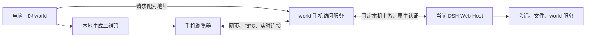

# world 手机扫码访问设计

> 日期：2026-11-13。设计基线：world 0.2.89；实现版本：0.2.90。已通过隔离的已安装 DSH + 浏览器手机视口验收，物理手机与公网部署尚未验证。
>
> Desktop 提供一个「手机连接」入口，显示二维码。手机扫码后直接加载当前 DSH 后台提供的 world 网页，沿用已有手机布局。

## 1. 已确定的范围

- 只修改 world 插件，复用正在运行的 DSH 后台。
- 手机使用浏览器扫码进入页面，无需安装专用客户端。
- Desktop 的正常界面只增加连接入口及二维码；错误时原位显示一句原因。
- 零新增第三方运行依赖；二维码在本地生成，不调用外部二维码服务。
- 手机与电脑共用后台会话、工作区、文件和 world 服务；页面在各自设备上渲染。
- 本文仅设计网络入口、认证、页面加载与必要的浏览器兼容处理。

本方案不实现 RDP、窗口截图传输、系统键鼠注入或新的 DSH Host。手机触摸和中文输入由网页正常处理。电脑现有窗口和手机页面的打开状态、编辑草稿、图标位置各自保存，不增加跨设备界面同步。

## 2. 已有能力与源码依据

| 已确认的源码事实 | 依据 | 对本方案的意义 |
| --- | --- | --- |
| workspace-teams 用原生认证 URL 启动 Edge/Chrome 的应用窗口 | [browser-launch.js](../workspace-teams/browser-launch.js)，`authenticatedUrl(...)` 与 `--app=...` | 可复用同一套 DSH Web 外壳和后台，无需另做 world 页面 |
| world 是 Web 客户端插件 | [package.json](./package.json)，`dsh.client.platform: web` | 手机能从宿主加载同一插件 bundle |
| world 已有窄屏桌面和应用切换 | [DESIGN.md](./DESIGN.md) 的手机布局、[responsive.js](./responsive.js)、[phone-browser.mjs](./tests/phone-browser.mjs) | 沿用当前布局，不再设计一套手机桌面 |
| Desktop Host 固定以 `127.0.0.1`、动态端口启动 | DSH `apps/desktop-host/src/index.ts` | 手机无法直接访问该监听，需要 world 内的转发入口 |
| 原生认证 URL 携带进程启动 token，经根页面兑换签名 Cookie | DSH `packages/client/connection/src/browser-auth.ts` | 可在转发服务内部建立原生认证连接；启动 token 不具备一次性、短时配对语义 |
| API 有 Host/Origin 校验；Cookie 与 authority 绑定 | DSH `packages/client/connection/src/api-request-trust.ts`、`browser-auth.ts` | 不能仅替换 URL 的 IP，也不能无校验地重写请求头 |
| 实时 Remote 流使用 `/api/remote.mux` WebSocket | DSH `packages/api/gateway/src/stream-protocol.ts`、`client/stream-client.ts` | 转发需覆盖 WebSocket Upgrade，单独代理 HTML 不够 |

DSH 源码依据来自本机 `E:/deepseek-harness`。上述为源码核对结果，不能代替已安装 DSH 版本的运行验证。

## 3. 用户流程

1. 在 Desktop 点击「手机连接」。world 检查当前 Web 服务，启动或复用手机访问入口，生成配对地址和二维码。
2. 手机用系统扫码功能打开浏览器。页面自动完成 token 兑换，随后进入 world；不增加账号输入或二次确认页面。
3. 手机正常打开 DSH 会话、查看助手进度、回复消息、处理可用的待办交互，或使用 world 应用。
4. 收起二维码不影响已建立的手机连接；关闭手机页面只释放该页面资源，不停止后台任务。

二维码过期时，可在原有二维码区域点击刷新。入口不增加设备列表、连接向导、网络配置面板或远程工具栏。用户已确认：入口采用开始菜单现有应用卡片，弹层复用已有样式；二维码为 240×240 CSS px，窄屏等比缩小。

手机已有有效会话时，刷新页面仍进入 world。手机浏览器进入后台或锁屏后，实时连接可能中断；返回页面时沿用 DSH 的重连机制重新读取当前状态，不重放已提交的消息或文件写入。

## 4. 架构：一个后台，一个插件内入口

world Host 使用 Node 内置 `http` / `https` / `crypto` / `os` / 流处理能力。通过可选的 `webServer` 服务读取当前上游 origin，不猜端口，不启动第二个 profile，不修改 DSH 核心配置或源码。

手机入口使用独立监听端口，应用挂在该 origin 的根路径 `/`。这样 DSH 的资源路径、插件 bundle 和 API 路径保持原样，无需把整个应用嵌入一个子路径再改写脚本。

入口绑定一个具体的可用网卡地址。0.2.91 起，未配置 `WORLD_MOBILE_HOST` 时，弹层提供「网卡名称 · IP」下拉框；只有一个地址则自动生成，多个地址则等待选择。重新打开时复用本次 Host 运行中上次选定的地址；选择的地址必须仍在当前候选列表内。配置了 `WORLD_MOBILE_HOST` 时优先使用该地址，不显示下拉框。切换地址时按需启动另一个接口监听，保留此前已建立的手机会话；退出时统一释放。允许通过 world 的配置覆盖绑定地址和对外 origin。不自动修改 Windows 防火墙。

## 5. 二维码与认证

### 地址与配对

二维码编码完整 URL，例如 `http://<电脑局域网地址>:<端口>/#world-pair=<token>`。这里的 token 由 world 随机生成，服务端有效期为 5 分钟，成功兑换一次后失效。地址由当前实际监听结果构造；这些时间参数属于本设计的默认值。

将配对 token 放在 fragment 中，避免扫码预览只请求 URL 就消耗 token。未登录的根页面仅返回 world 自带的极小引导页；该页读取 fragment，自动 `POST /_world_mobile/pair`。兑换成功后清理地址栏，并重新加载干净的 `/`，获得真实 DSH 页面。失败时只显示重新扫码的提示。

配对请求必须串行占用 token，避免并发兑换产生多份会话。内部原生认证成功后才提交兑换；失败不留下半建立的手机会话。HTTP 访问日志不记录配对值、Cookie 或 DSH 启动 token。

### 复用原生认证

手机 Cookie 与 DSH 上游 Cookie 分开管理：

1. world 用 `ctx.connection.authenticatedUrl(upstreamOrigin + '/')` 在服务端请求根页面。
2. 接收 DSH 的登录重定向与 Cookie，将 Cookie 留在该手机会话对应的服务端内存中。
3. 手机只收到 world 自己的随机会话 Cookie，后续请求由 world 查会话并附加该上游 Cookie。
4. DSH 启动 token 和上游 Cookie 不进入二维码、手机脚本或手机响应头。

手机会话默认绝对有效期 8 小时，`HttpOnly`、`SameSite=Strict`、`Path=/`；经 HTTPS 时添加 `Secure`。world 服务停止、插件卸载或 DSH 退出后，销毁会话并关闭相关流；重启后重新扫码。重新生成二维码使上一份未使用的配对 token 失效，已建立的手机会话按自己的期限保持。

本方案用于本人设备访问同一个 DSH，手机以现有 owner 身份使用后台。原有沙箱和操作审批继续生效；它不是「仅允许 world、禁止其他已装插件」的访客授权系统，也不增加无人值守的自动审批。

### 本地生成二维码

world 内提供纯 JavaScript 编码模块，将 URL 编码为 QR Code 并输出 SVG；不加载 CDN、图片接口、原生组件或扫码 SDK。手机扫描由系统扫码功能完成。编码器按 URL 长度选择版本，覆盖完整数据编码、纠错与静区要求；实现后用独立解码验证及真实手机扫码验收，不能只看图形外观。

## 6. 转发契约

| 请求类型 | 处理 |
| --- | --- |
| 未登录的根页面及配对引导资源 | 返回插件内引导页和必要静态文件，不暴露 DSH 页面 |
| `POST /_world_mobile/pair` | 校验一次性 token，建立手机会话 |
| 已登录的根页面、JS、CSS、插件资源 | 从当前固定 DSH 上游流式转发 |
| RPC、文件上传及下载 | 保留方法、请求体、内容类型和状态码，继续交给原生处理器 |
| SSE、长轮询 | 不整段缓存响应，保留取消与背压；客户端断开时取消对应上游请求 |
| `/api/remote.mux` WebSocket | 鉴权后转发 Upgrade 和双向字节流；处理初始 `head` 数据，任一端关闭时清理另一端 |
| `/_world_mobile/lan-chat/*` | 鉴权后转到本实例的局域网聊天服务，去掉专用前缀 |

WebSocket 复用 Node 的 HTTP Upgrade 与 socket 管道，不新增 WebSocket 服务端库，也不重新解释 DSH 流协议。

转发仅允许当前 DSH origin 和本实例聊天服务两个已知上游；目标不由手机参数指定。转发层先检查外部请求的 Host、Origin、跨站标记和手机会话，再将上游 Host、Origin、Cookie 规范化为固定本机连接的值。移动端提交的上游凭据和转发头不直接透传。

这个顺序保留手机入口自己的浏览器信任边界，不能把任意请求改成 `localhost` 后交给 DSH 当作已授权操作。普通 HTTP 和 WebSocket 握手使用相同的检查。

上游 `Set-Cookie` 由服务端会话管理，不能原样覆盖手机会话 Cookie。指向已知上游的重定向改为手机 origin 下的等价地址，认证过程不跟随任意外部地址携带凭据。页面资源和事件连接必须落在手机访问的 origin；若当前安装版在启动注入中写入本机绝对地址，先验证能否在 world 转发边界作局部兼容，不修改宿主，也不对所有 JS 做字符串替换。

## 7. 页面与应用的兼容范围

| 功能 | 手机访问行为 | 必要处理 |
| --- | --- | --- |
| world 桌面、应用切换 | 手机浏览器自行渲染 | 复用当前窄屏布局 |
| DSH 会话、消息、实时进度和审批 | 使用当前 Host 的原生页面及 API | 验证 RPC 与事件连接，审批由用户正常操作 |
| VSCode、终端、日记、待办 | 使用服务机上的对应 world 服务 | 保留现有权限与文件版本冲突检查；终端命令运行在电脑上 |
| 局域网聊天 | iframe 使用同源聊天转发路径 | 修正当前 `127.0.0.1` 地址和主题 `postMessage` 的目标 origin |
| 聊天页内部请求 | 经专用前缀访问聊天 API | 当前 `app.js` 使用 `/api/state`、`/api/events` 等根绝对路径，须统一增加 URL 基址解析，防止误发给 DSH API |
| world 内置浏览器 | 沿用 iframe 兼容模式 | 手机没有 Electron guest 桥；禁止被嵌入的网站继续使用已有的浏览器外部打开入口 |
| 在系统资源管理器中显示 | 仍是服务机侧行为 | 不伪装为手机文件选择或手机目录 |
| `.worldapp` 和其他整页插件 | 按各自 Web 能力运行 | 不承诺依赖 Electron 或本机地址的第三方应用全部兼容 |

聊天页面和服务也属于 world，必要的路径适配均在插件目录内完成。本方案没有逐应用截图或输入模拟。

## 8. 数据与多客户端行为

- 共享当前 Host 的会话事件、工作区、文件，以及 world 的日记、待办、助手设定和生活线。服务仍由原 Host 启动一次。
- 手机单独维护应用打开状态、图标布局、localStorage 和未保存草稿；不会把手机尺寸写入电脑的桌面布局。
- 两端编辑同一文件时沿用现有版本检查；不能以「手机同步」覆盖电脑的新内容。
- 扫码登录不自动把桌面控制权交给助手，不迁移电脑正在执行的桌面动作。
- 手机页面会成为现有 desktop bridge 的另一个客户端。工具操作继续要求明确目标 `desktopId`，不以「最后连接的页面」覆盖电脑目标。
- 电脑原生窗口最小化不等于关闭 Web Host；本方案不依靠原生窗口画面。退出 DSH、电脑睡眠或网络不可达仍会中断访问。

## 9. 网络与零依赖边界

首轮验收使用同一局域网或已有可达网络。二维码采用手机可达的电脑地址，不能使用 `127.0.0.1`。换网、IP 变化或监听端口变化后重新生成链接；不在二维码里承诺固定的公网设备地址。

移动网络访问需要服务地址已可达，例如已有 VPN、公网入口或用户现有的转发设施。world 可配置对外 origin，但填写地址不会创建公网连通；本期不新增云端中继、自动打洞或外部基础设施。

Node 的 HTTP/HTTPS、随机数和流处理来自宿主内置运行时。正式的网络部署可由 world 的 HTTPS 监听或已有可信 HTTPS 入口提供加密，证书与信任由部署环境提供，不引入证书申请服务依赖。同一可信局域网的原型允许 HTTP，但 token、Cookie 和操作在该链路上是明文；不能把这种原型称为已完成公网部署。

## 10. 预期文件职责

实现按以下文件分工：

| 文件 | 职责 |
| --- | --- |
| `mobile-access.js` | 服务生命周期、地址选择、配对 token、手机会话和桌面端 RPC |
| `mobile-proxy.js` | 固定上游 HTTP/SSE/WebSocket 转发与请求边界 |
| `mobile-qr.js` | 无第三方依赖的二维码编码及 SVG 输出 |
| `mobile-connect.js` | Desktop 的最小连接入口、二维码与刷新/错误状态 |
| `index.js` | 接入已有 Host 生命周期，按需读取 `webServer` 与聊天服务 |
| `client-src.js` | 接入连接入口，保留现有手机桌面 |
| `lan-chat-app.js`、`lan-chat/app.js` | 手机来源下的同源地址与聊天 API 基址适配 |

手机连接使用经过原生认证的 `world-mobile/addresses` RPC 读取网络候选项、`world-mobile/open` RPC 为选定地址生成配对链接；手机转发入口不通过公开 GET 返回该凭据，也不开放这两个管理操作。服务不能因为没有 `webServer` 而让整个 world 加载失败，该入口应原位显示不可用原因。

沿用当前客户端构建与打包流程，不修改 DSH、workspace-teams 或其他插件。二维码编码模块随 world 打包。

## 11. 验证次序与通过标准

| 阶段 | 验证 | 通过标准 |
| --- | --- | --- |
| P0 当前安装版的 Web 页面 | 用已有认证 URL 在独立浏览器打开同一个 Host | 能加载 world；记录真实资源、RPC、WebSocket 地址，不另启 Host |
| P1 最小转发 | 通过插件入口加载根页面、资源、API、实时连接 | 页面可操作，实时消息持续更新；没有向手机 `localhost` 发出的后台请求 |
| P2 扫码与认证 | 独立解码 QR，验证过期、并发、重复兑换和无 Cookie 请求 | QR 内容等于生成 URL；单次兑换；无会话的 API 与 Upgrade 被拒绝；不泄露上游凭据 |
| P3 两端共享后台 | 手机打开会话、发一条中文消息、查看电脑侧对应事件 | 进入同一个 Host 与会话，不重复发消息、不自动批准操作 |
| P4 world 应用 | 文件打开与保存、版本冲突、终端、日记、待办、聊天 | 操作作用于服务机，聊天的资源、API 和 SSE 都走同源专用路径 |
| P5 生命周期与设备 | Android 浏览器、iPhone Safari；刷新、切后台再返回、插件卸载、Host 重启 | 正常恢复或提示重扫；写操作不自动重放；退出时无残留 socket 与会话 |

P0/P1 决定现有宿主是否足以承载方案，先做它们，再实现二维码入口。现有手机布局测试不等于已经通过远程访问验证；待真正实现时补充转发、配对及真实浏览器链路测试。

0.2.90 实现验收：`tests/mobile-access.test.js` 覆盖配对、过期与撤销、Host/Origin 拒绝、HTTP 字节转发、SSE 和 WebSocket 初始数据；`tests/mobile-runtime.mjs` 使用已安装 DSH 和独立 home，分别通过 loopback 与本机实际 LAN IP 验证两端共享中文待办、手机刷新、原生实时帧和聊天 SSE。QR 由 Python/OpenCV 独立解码。真实 Android/iPhone 设备及公网条件仍待使用环境验证。

## 12. 首版交付判断

用户在电脑打开唯一连接入口，用手机扫码，直接进入可操作的 world 手机页面；可以打开同一个 DSH 会话、发送中文消息，并在电脑看到对应结果。之后刷新、断线重连、关闭手机页面均不产生额外提交或停止后台工作。

满足这一链路后再评估公网接入或其他扩展。二维码入口保持最小，不增加远程桌面管理产品的其他界面。

## 参考

- [Node.js HTTP](https://nodejs.org/api/http.html)：流式代理和 Upgrade。
- [Node.js HTTPS](https://nodejs.org/api/https.html)：使用已有运行时和证书提供 TLS 入口。
- [MDN Set-Cookie](https://developer.mozilla.org/en-US/docs/Web/HTTP/Reference/Headers/Set-Cookie)：手机会话 Cookie 属性。
- [DENSO WAVE QR Code margin](https://www.qrcode.com/en/howto/code.html)：二维码静区要求。
