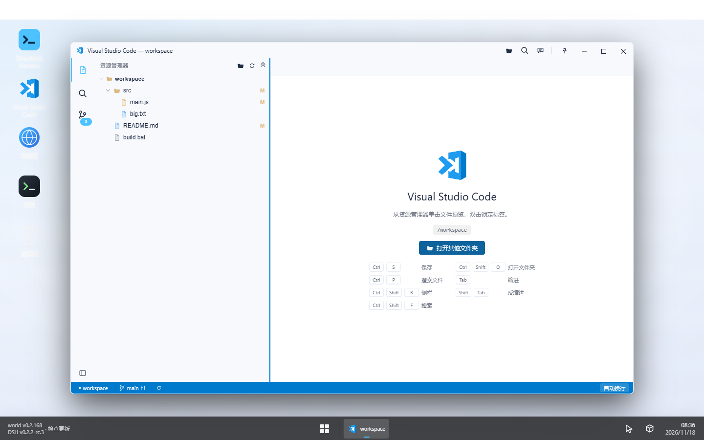
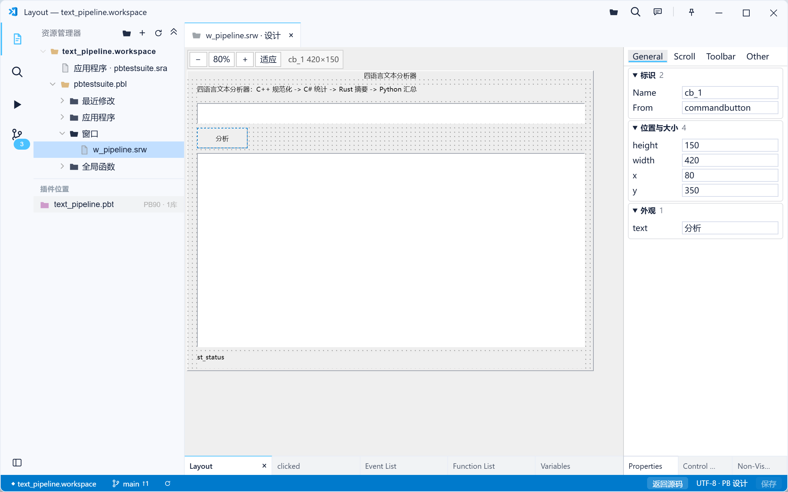
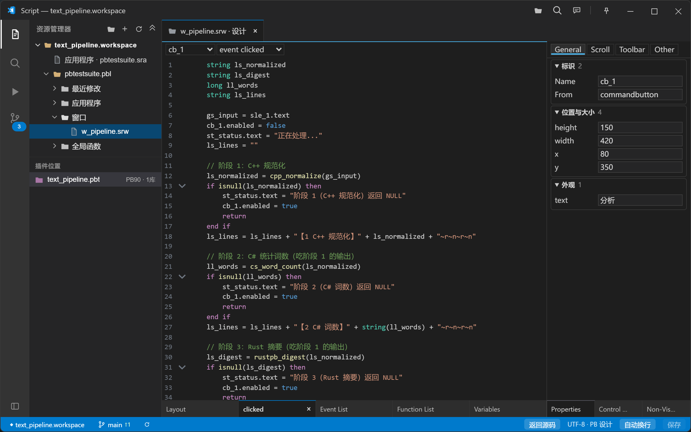

<div align="center">

<h1>world</h1>

<p><strong>把 DeepSeek Harness 变成一台 Windows 11。</strong></p>

<p>壁纸、图标、开始菜单、任务栏和可以拖动的窗口，内置 VSCode、终端、浏览器与局域网聊天，<br />
还有一位有自己的时间、记忆和日记的助手，和你共用这张桌子。</p>

<p>
  <a href="./CHANGELOG.md"></a>
  <a href="./LICENSE"></a>
  
  
</p>

<p>
  <a href="#安装">安装</a> ·
  <a href="#快速上手">快速上手</a> ·
  <a href="#功能">功能</a> ·
  <a href="#与模型协作">与模型协作</a> ·
  <a href="#文档">文档</a> ·
  <a href="#开发">开发</a>
</p>

</div>

---

## 这是什么

world 是 [DeepSeek Harness](https://github.com/deepseek-ai/deepseek-harness)（下称 `dsh`）的桌面插件。装上它，dsh 不再只是一个聊天窗口，而是一台可以点、可以拖、可以往里摆东西的桌面：

- **桌面**：壁纸、图标、开始菜单、任务栏、可拖动 / 缩放的窗口；甩到顶边最大化，甩到左右边缘占半屏，点任务栏收回。
- **应用**：内置 VSCode（含 PowerBuilder 设计器与 ZIP 工作区）、终端与 SSH、多标签浏览器、局域网聊天、进程管理器、日记与待办。
- **助手**：把桌面交给她之后，她用自己的鼠标干活；她也有自己的闹钟、记忆和日记——不是每轮被叫起来的一条提示词。
- **手机**：扫码进入同一个后台，窄屏变成手机桌面；会话、文件、日记、待办都是同一份。

桌面和虚拟窗口绘制在宿主页面里，DSH 的原界面就放在其中一扇窗口中，不接管系统窗口。文件操作、终端子进程和局域网聊天服务则运行在 DSH 宿主侧。

## 界面



**SRW 窗口设计**：在示例工程 `text_pipeline.pbt` 中打开 `w_pipeline.srw`。选中画布上的「分析」按钮，右侧显示它的名称、位置和尺寸，左侧工程树高亮当前窗口文件。



**Script 事件脚本**：双击同一个按钮，切到 `cb_1.clicked`。深色主题下可以分辨 PowerScript 的类型、控制流、函数、字符串和注释。



## 功能

| 模块 | 能做什么 | 文档 |
| --- | --- | --- |
| 桌面与窗口 | 拖动、八边缩放、顶边最大化、左右半屏、吸附预览、叠放与钉住、沉浸启动 | [docs/desktop.md](docs/desktop.md) |
| 开始菜单 | 搜索应用 / 文件 / 插件，安装内置应用，直达宿主的设置与插件页 | [docs/desktop.md](docs/desktop.md#开始菜单搜索) |
| 内置 VSCode | 编辑、预览 / 固定标签、语法高亮、项目搜索、Git、SRW/SRU/SRD/SRM 设计器、ZIP 工作区 | [docs/vscode.md](docs/vscode.md) |
| 终端与 SSH | 一条命令一个子进程、ANSI、Tab 补全、历史搜索、远程会话与主机密钥确认 | [docs/terminal.md](docs/terminal.md) |
| 浏览器 | 复用主进程 webview 租约，多标签、地址栏白名单、起始页搜索 | [docs/browser.md](docs/browser.md) |
| 局域网聊天 | UDP 自动发现、私聊群聊、跨网段种子、模型好友 @ 派活 | [docs/lan-chat.md](docs/lan-chat.md) |
| 助手与生活 | 一个闹钟、四种唤醒、按天原文记忆、自己写的自述、日记与待办 | [docs/life.md](docs/life.md) |
| 手机访问 | 二维码配对、长期有效、手机桌面与触控尺寸 | [docs/mobile.md](docs/mobile.md) |
| 进程与网络 | 进程管理器、端口占用、存储清理、启动项、EasyTier 上网、调试日志、检查更新 | [docs/ops.md](docs/ops.md) |
| 外部应用 | `.worldapp` 拖放安装，只含数据、不执行包内代码 | [docs/desktop.md](docs/desktop.md#外部应用包worldapp) |

## 安装

需要 **DeepSeek Harness 桌面版**。Windows 是主要平台，macOS / Linux 部分能力可用，见[平台与限制](#平台与限制)。

### 从 GitHub 安装（推荐）

源码就在 <https://github.com/Pualajjw/world>，可以让 dsh 直接拉取安装，不需要先打包。安装前请准备好 Node.js / git（桌面版自带的 CLI 已包含 pnpm）。

如果 `dsh` 已在 PATH 里，PowerShell 和 cmd 都可以直接运行：

```text
dsh plugin --profile desktop add github:Pualajjw/world
```

否则用桌面版自带的 CLI。以下是 Windows 默认安装路径；若装在别处，请替换路径。

**PowerShell**（带引号的程序路径前需要 `&`）：

```powershell
& "$env:LOCALAPPDATA\Programs\DeepSeek Harness\resources\runtime\cli\bin\dsh.cmd" plugin --profile desktop add github:Pualajjw/world
```

**cmd**：

```bat
"%LOCALAPPDATA%\Programs\DeepSeek Harness\resources\runtime\cli\bin\dsh.cmd" plugin --profile desktop add github:Pualajjw/world
```

装完**重启 DeepSeek Harness**（菜单退出后重新打开）。任务栏左下角出现 `world v… · DSH v…`、开始菜单里出现「设置」「日记」「待办」，就说明装上了。下文以已加入 PATH 的 `dsh` 为例。

**版本与分支**：跟踪 `main` 时运行：

```text
dsh plugin --profile desktop add "github:Pualajjw/world#main"
```

要锁定某个提交，把下面的提交号换成目标提交：

```text
dsh plugin --profile desktop add "github:Pualajjw/world#4fddc6b"
```

- **更新**：重新安装不带提交号的默认分支或 `#main`，然后重启 dsh。重复安装同一提交号不会更新到 `main`。
- **卸载**：`dsh plugin --profile desktop remove @local/dsh-world`。

**需要代理时**，先在当前终端设置代理地址，再在同一终端执行安装命令：

PowerShell：

```powershell
$env:HTTPS_PROXY = 'http://127.0.0.1:7890'
$env:HTTP_PROXY = $env:HTTPS_PROXY
```

cmd：

```bat
set "HTTPS_PROXY=http://127.0.0.1:7890"
set "HTTP_PROXY=%HTTPS_PROXY%"
```

### 离线安装（TGZ）

用本机构建出来的 `dist/world-<版本>-universal.tgz`：

```bat
dsh plugin --profile desktop add file:E:\path\to\world-0.3.66-universal.tgz
```

### 通过 pbpkg 源安装

如果所在团队的 [pbpkg](https://gitee.com/paulajam/pbpkg) 源里发布了 world，也可以直接在插件页的列表里安装、重装或切换版本；world 的「检查更新」会优先使用当前启用的 pbpkg 源。源里没有 world 时，按上面两种方式安装。

### 升级

- 点任务栏左下角的「检查更新」。它只提示、不自动安装，确认后交给 DSH 插件管理器安装，重启生效。细节见 [docs/ops.md](docs/ops.md#检查更新与内置升级)。
- 也可以重跑 `add` 命令覆盖安装。
- 从源码目录链接（`link:` / `workspace:`）进来的开发实例可以检查更新，但不直接自升级。

## 快速上手

1. **打开桌面**：双击桌面上的 DeepSeek Harness 图标，DSH 原界面进入一扇虚拟窗口；再双击图标或点任务栏可以还原。
2. **摆窗口**：拖标题栏移动；甩到顶边最大化，甩到左 / 右边缘占半屏；点任务栏上已在前台的按钮会收回窗口。
3. **开始菜单**：搜索框直接打字，能搜应用、文件和插件；「设置」「插件」会打开对应的 DSH 原生面板。在下方「插件」分组点 **pbnpm**（也可搜索），未安装时显示可安装版本，已安装时显示本机版本并提供「重装」。已禁用的插件会标为「已禁用」，重装后仍保持禁用。优先用本地 pbpkg 开发源，没有可用包时直连 Gitee；确认框显示实际来源和目标版本。
4. **装应用**：VSCode、浏览器和终端默认已安装，可以卸载；局域网聊天按需安装。装好后桌面出现图标，VSCode 还能同时开多个窗口。
5. **桌面本身**：右键壁纸可以「个性化 / 刷新」，右下角 `3D` 切换景深；图标可以拖动、合并成收纳盒；把 Windows 文件拖进桌面只记录路径，不复制文件。
6. **手机连接**：开始菜单 →「手机连接」→ 选网卡 → 手机扫码。手机和电脑共用同一个 DSH 后台，窗口布局与未保存草稿各自独立。
7. **交给她**：点任务栏右侧「交给助手」，允许固定助手使用已绑定的应用工具；点「换你来」可收回授权，但不会停止已经启动的命令。详见 [docs/life.md](docs/life.md)。
8. **升级**：任务栏左下角「检查更新」。

## 与模型协作

打开**开始菜单 → World 设置 → 助手使用电脑**，可以查看每个 DSH 工具交给哪个应用。比如，保留 `read → VSCode` 的默认绑定，再点任务栏「交给助手」，请她读取工作区里的文件。工具仍须通过 DSH 原有的审批与沙箱；未绑定或所属应用未安装时，固定助手不能调用它。

| 默认所属应用 | 工具示例 |
| --- | --- |
| VSCode | `read`、`write`、`edit`、`grep`、`glob`、`apply_patch` |
| 终端 | `pwsh`、`bash`、`run_code` |
| 日记 / 待办 | 日记：`world_diary`、`world_memory`、`world_self`；待办：`world_tasks` |
| 局域网聊天 | `lan_chat_conversations`、`lan_chat_history` |

`world_life` 默认未绑定；需要让助手自己定闹钟时，先在 World 设置中将它绑定到已安装的应用，再开启「给她自己的时间」。

**「换你来」撤销的是桌面授权，不是停止任务。** 接管后，助手不能再凭这次授权发起工具调用，排队等着显示的动作会清空；宿主已经启动的命令或构建仍可能继续。详见[助手手册](docs/life.md#与模型共用桌面)。

## 数据与隐私

以下是保存在本机 `DSH_HOME` 下的主要文件。world 不另行收集使用遥测；本地保存不代表内容只在本机使用。

| 路径 | 内容 |
| --- | --- |
| `world/life.json` | 一个闹钟、下一次回顾、是否已到家 |
| `world/self.md` | 她自己写的「我是谁」（≤ 4000 字） |
| `world/self.history/<日期>.md` | 每次回顾前留下的旧自述 |
| `world/conversations/<日期>.jsonl` | 她这个会话说过的话，按天、原文 |
| `world/activity/<日期>.jsonl` | 工具调用记录，只给下一次闹钟对照 |
| `world/journal.json` | 日记与垃圾箱 |
| `world/tasks.json` | 待办清单 |
| `world/mobile.json` | 手机配对密钥（`0600`，重启不换码） |
| `world/brain.json` | 固定助手会话的绑定 |
| `world/launch.json` | 桌面快捷方式的启动意图 |

**模型会收到什么**：固定助手的自述会进入系统提示词；闹钟、早间唤醒与每日回顾还会附上最近最多 40 条对话。若 DSH 使用远程模型，这些内容会随请求发给所选模型服务。

**界面偏好存在哪里**：桌面布局、图标与窗口位置、最近打开的文件夹和应用工具绑定使用当前浏览器的 `localStorage`，浏览器可以将其持久化到磁盘。内置浏览器不读取网页正文、不注入脚本，也不代理网页流量。

## 文档

| 文档 | 内容 |
| --- | --- |
| [docs/desktop.md](docs/desktop.md) | 桌面、开始菜单、窗口吸附与叠放、图标、收纳盒、3D 景深、外部应用包 |
| [docs/vscode.md](docs/vscode.md) | 内置 VSCode：编辑、搜索、Git、PB 设计器、ZIP 工作区、Markdown 单元测试 |
| [docs/terminal.md](docs/terminal.md) | 终端与 SSH 会话 |
| [docs/browser.md](docs/browser.md) | 内置浏览器与三档后端 |
| [docs/lan-chat.md](docs/lan-chat.md) | 局域网聊天与模型好友 |
| [docs/life.md](docs/life.md) | 与模型共用桌面、她的时间与记忆、日记与待办 |
| [docs/mobile.md](docs/mobile.md) | 手机扫码与手机桌面 |
| [docs/ops.md](docs/ops.md) | 进程管理器、存储清理、端口、上网、启动项、调试日志、检查更新 |
| [DESIGN.md](DESIGN.md) | 架构、窗口装填方式、状态机、视觉 token、风险 |
| [BROWSER-DESIGN.md](BROWSER-DESIGN.md) | 主进程 webview 租约契约、三档后端、P0 探针 |
| [MOBILE-ACCESS-DESIGN.md](MOBILE-ACCESS-DESIGN.md) | 手机网页入口的设计与边界 |
| [APP-FORMAT.md](APP-FORMAT.md) | `.worldapp` 格式 |
| [lan-chat/TROUBLESHOOTING.md](lan-chat/TROUBLESHOOTING.md) | 「我能看到它、它看不到我」的五步排查 |
| [CHANGELOG.md](CHANGELOG.md) | 更新日志 |
| [ROADMAP.md](ROADMAP.md) | 从 P0 开始的实现清单 |

可点原型在 [`prototype/index.html`](prototype/index.html)，直接用浏览器打开。

## 开发

**安装插件不需要构建。** 若要修改客户端或生成离线包，请使用 [pbhelp 完整工作区](https://gitee.com/paulajam/pbhelp)，而不是只克隆 GitHub 上的 `world` 目录。`build-client.mjs` 会从相邻的 `pbpkg` 查找 `esbuild`，`package.mjs` 直接导入 `../project-tree/package-plugin.mjs`；单独在 world 里运行 `npm ci` 不会准备这两项。

以下命令在 Windows 上从 **pbhelp 仓库根目录**执行，需要 Node.js 22 或以上、npm，以及 PATH 中的 `tar.exe`：

```powershell
cd .dsh/plugins/world
npm.cmd --prefix ../pbpkg install --include=dev --no-package-lock --legacy-peer-deps
npm.cmd ci --legacy-peer-deps
node build-client.mjs
node package.mjs
```

产物为 `dist/world-<版本>-universal.tgz`，按[离线安装](#离线安装tgz)一节添加后重启 dsh。改了 `client-src.js`、`styles.css` 或任一 `*-app.js` 后，请先重新构建客户端再打包。

常用回归：

| 命令 | 覆盖 |
| --- | --- |
| `npm test` | Node 侧单测：模型、Git、终端、SSH、窗口布局、高亮、日记、待办、启动等 |
| `npm run test:browser` | 完整桌面回归（Edge + playwright-core） |
| `npm run test:vscode` / `test:tabs` / `test:git` | 编辑器、标签组、Git 工作流 |
| `npm run test:srw` / `test:srd` / `test:srm` | PowerBuilder 窗口、DataWindow、菜单设计器 |
| `npm run test:mobile` | 真实宿主下的扫码连接、SSE 与手机页面（需 `DSH_TEST_CLI`） |
| `npm run test:performance` | 空闲、拖动、滚动与打字的开销对比 |

浏览器测试还从相邻的 `workflow-studio` 加载 `playwright-core` 等测试依赖。在 world 目录先运行 `npm.cmd --prefix ../workflow-studio ci --legacy-peer-deps`，并准备本机 Edge；完整桌面回归可用 `WORLD_BROWSER` 指定浏览器路径，用 `WORLD_BROWSER_SHOTS_DIR` 留档截图。

| 路径 | 作用 |
| --- | --- |
| `index.js` | 宿主侧：服务、RPC、工具、生活线与启动逻辑 |
| `client-src.js` → `client.js` | 桌面源码与构建产物 |
| `vscode-app.js` / `terminal.js` / `browser-frame.js` | 内置应用 |
| `lan-chat/` | 局域网聊天服务与页面 |
| `tests/` | 单元测试与浏览器回归脚本 |
| `docs/` | 功能手册 |

## 平台与限制

- **Windows 优先**。Linux / macOS 已有进程、端口、EasyTier 的适配与夹具测试，但尚未完成对应真机验收。
- **沉浸模式的边界**：宿主原生标题栏与 Windows 系统任务栏不在 world 的 DOM 里，沉浸模式只铺满 DSH 内容区。
- **终端没有 PTY**：`vim`、`top`、`ssh` 密码登录这类必须交互的程序用不了；远程会话走「一条命令一个子进程」。
- **浏览器受主进程策略限制**：不支持下载、摄像头 / 麦克风 / 定位 / 通知、`alert/confirm/prompt`、HTTP Basic 登录；Cookie 在 DSH 重启后清空。受限时用地址栏右侧「在系统浏览器打开」。
- **手机需要可达的网络**：默认走局域网与 `53319` 端口，Windows 防火墙需放行；跨网访问要已有 VPN / 反向代理 / HTTPS 入口，插件不会自己穿透。
- **内置 VSCode 不是 VS Code**：没有终端、扩展市场、调试器，界面上只有真正能用的资源管理器、搜索和源代码管理。
- **大文件分档**：≤ 1 MiB 普通编辑器，1–8 MiB 可编辑的虚拟化视图，> 8 MiB 只读浏览。
- **PowerBuilder 相关功能**需要 Windows，以及 `pbnpm` / `pbnpm-pbd` 插件与对应的 PB 运行时。

## 许可

[MIT](./LICENSE) © 2026 Puala。

内置编辑器组件（CodeMirror 6、`@zip.js/zip.js` 等）的许可证见 [THIRD-PARTY-NOTICES.txt](./THIRD-PARTY-NOTICES.txt)。PowerBuilder、Sybase、SAP 等名称与商标归其各自所有者，本项目与它们没有隶属关系。
